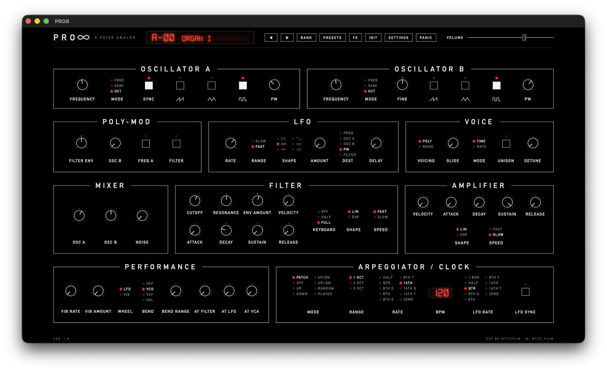

# PRO8

**An 8-voice analog polysynth plugin for macOS — CLAP, VST3 and AU.**

PRO8 is a circuit-level emulation of the Behringer PRO-800, a modern 8-voice poly descended from the Prophet-600.
It was built side by side with a real unit, with every stage of the signal path measured on the hardware and
matched in the code — not designed by ear, not approximated from a manual.

DSP by **mtzvfilm** · ig: [mtzv_film](https://instagram.com/mtzv_film)

### ⬇ [Download PRO8 1.0.1 for macOS](https://github.com/mtzvfilm/PRO8/releases/latest) — CLAP + VST3 + AU in one installer

## Sound demos

### 🔊 [Listen in the browser](https://mtzvfilm.github.io/PRO8/)

Rendered straight from the plugin engine with its built-in effects, presets from the PRO8 bank (no external processing):

| | preset | |
|---|---|---|
| ▶ [01 Velvet Horizon](docs/media/audio/01_velvet_horizon_pad.m4a) | pad | detuned saws, chorus I, hall |
| ▶ [02 Cloud Choir](docs/media/audio/02_cloud_choir_pad.m4a) | pad | soft wide pad, chorus II, cloud reverb |
| ▶ [03 Deep Field](docs/media/audio/03_deep_field_ambient.m4a) | ambient | slow-swept texture, tape delay, cloud reverb with shimmer |
| ▶ [04 Glass Rain](docs/media/audio/04_glass_rain_ambient.m4a) | ambient | glassy melody, ping-pong delay, plate |
| ▶ [05 Earth Hum](docs/media/audio/05_earth_hum_drone.m4a) | drone bass | low resonant drone, glide |
| ▶ [06 Chrome Lead](docs/media/audio/06_chrome_lead.m4a) | lead | lead with glide and delayed vibrato, tape delay |

---

## Measured, not guessed

The engine was calibrated against thousands of raw recordings taken from the hardware through a studio interface,
using automated measurement scripts that drove the unit over MIDI and SysEx and analysed every take:

- **Oscillators** — the 16 VCOs, one by one: waveforms, pulse-width law, sync, hard-sync transients, high-pitch roll-off,
  and the individual tuning offset and long-term drift of each oscillator, logged over 20 hours.
- **Filter** — a grey-box model of the V3320 4-pole OTA ladder: cutoff law over a dense knob × resonance grid,
  self-oscillation onset and pitch on all 8 voices from 80 Hz to 12 kHz (matched within 0.7 CC), the resonance loop,
  input-cell asymmetry and intermodulation.
- **Envelopes and VCA** — attack, decay and release curves in both speed ranges and both shapes, the CV slew of the
  amplifier, velocity and aftertouch laws.
- **Modulation** — LFO rates and shapes, poly-mod at audio rate, vibrato, glide, pitch bend, unison detune fan of
  every voice pair.
- **Voice behaviour** — voice assignment, retriggering of repeated notes, chords, legato.

Whole presets were then compared hardware-vs-plugin by ear and by analysis until the two sat side by side.
The result: the character of the instrument — its slightly different eight voices, its drift, the way the filter
sings — not a generic "analog-style" synth.

## Features

- 8-voice analog engine (up to 64 voices), 2× oversampled, multi-core voice rendering
- Two VCOs per voice with saw / triangle / pulse, sync, poly-mod, noise
- 4-pole resonant filter with self-oscillation, filter and amplifier envelopes
- LFO with six shapes and five destinations, delayed modulation, vibrato
- Unison (2 / 4 / 6 / 8 voices), **poly unison** (every note gets its own stack), mono and poly modes, glide
- Arpeggiator: up, down, up/down, up-then-down, random, as played; 1–3 octaves; straight, dotted, triplet and swing rates
- Tempo sync to the DAW (or its own BPM); tempo-synced LFO
- **Analog character**: VINTAGE (from eight identical voices through the measured instrument to a well-worn one) and
  OSC SPREAD; master tune A = 415–465 Hz
- Effects stored with every preset: BBD chorus (I / II / I+II), delay (tape, BBD, digital ping-pong), reverb (plate,
  hall, cloud with shimmer)
- Preset library: 26 banks × 100 presets, bank and preset import/export as **.syx** (PRO-800 compatible — files load
  on the hardware) and **.fxp / .fxb**
- MIDI CCs follow the PRO-800 MIDI map
- Factory content: a 100-patch PRO8 bank (pads, ambient, drones, leads, arpeggios); your own PRO-800 banks load as .syx

## Installing

Download `PRO8-1.0.1.pkg` from [Releases](https://github.com/mtzvfilm/PRO8/releases/latest). The installer is not signed
with an Apple developer certificate: right-click it → **Open** (or System Settings → Privacy & Security → **Open Anyway**).
The plugins are installed to `/Library/Audio/Plug-Ins`; presets live in `~/Library/Application Support/PRO8/Banks`.

## Building (macOS 11+, Apple Silicon and Intel)

CLAP, VST3 and AU, through [clap-wrapper](https://github.com/free-audio/clap-wrapper):

    brew install cmake ninja
    git clone --depth 1 https://github.com/free-audio/clap.git plugin/third_party/clap
    git clone --depth 1 https://github.com/free-audio/clap-wrapper.git plugin/third_party/clap-wrapper
    cmake -S plugin -B plugin/build -G Ninja -DCMAKE_BUILD_TYPE=Release
    cmake --build plugin/build          # installs to ~/Library/Audio/Plug-Ins
    sh plugin/make_pkg.sh               # plugin/build/PRO8-1.0.1.pkg (CLAP + VST3 + AU)

## Layout

| path | |
|---|---|
| `dsp/` | voice engine (portable C++17) and effects |
| `core/pro8_core.*` | one synth instance: engine + effects + presets + panel bridge + state |
| `core/ui.html` | the panel |
| `plugin/` | CLAP plugin, VST3 / AU wrapping, installer |
| `docs/` | project page (GitHub Pages), screenshot and sound demos |

## License

PRO8 is free software, released under the **GNU General Public License v3.0** — see [LICENSE](LICENSE).
Copyright © 2026 mtzvfilm. Third-party components keep their own licenses: CLAP and clap-wrapper (MIT), VST3 SDK (MIT),
AudioUnitSDK (Apache 2.0), DSEG font (SIL OFL 1.1, `core/fonts/DSEG-LICENSE.txt`) — full texts in
[`plugin/resources/THIRD_PARTY_LICENSES.txt`](plugin/resources/THIRD_PARTY_LICENSES.txt), also shipped inside every plugin bundle.

## Disclaimer

PRO8 is an independent project, not affiliated with or endorsed by Behringer / Music Tribe or Sequential. Behringer, PRO-800,
Sequential and Prophet-600 are trademarks of their respective owners; they are named only to describe the instrument that
was measured. No factory presets or firmware of the hardware are distributed with PRO8. VST is a registered trademark of
Steinberg Media Technologies GmbH; Audio Units is a trademark of Apple Inc.
